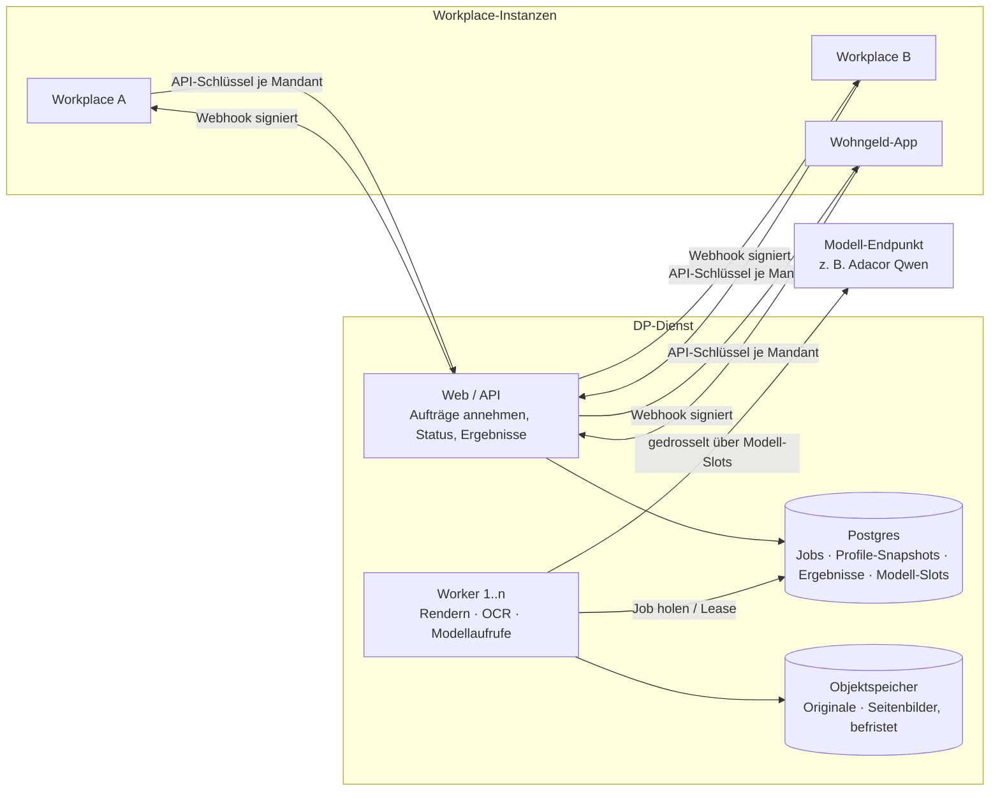

# Konzept: Document Processing als eigenständiger, skalierbarer Dienst (2026-09-25)

Status: Diskussionsgrundlage für das Produktteam. Ergänzt die Übergabe
`docs/document-processing-uebergabe-simon-2026-09-04.md` (dort: Einbau ins Produkt-Workplace, §7
„Integrationsnähte") um die Variante „eigener Dienst, per API von allen Workplaces genutzt".

---

## 1. Anlass

- Document Processing (DP) hat ein anderes Lastprofil als der übrige Workplace: kurze, starke Spitzen bei Speicher
  und Rechenzeit (PDF-Rendering mit poppler, Bildmodell-Aufrufe), lange Laufzeiten (80–150 s je Sammel-PDF mit 20–40
  Seiten) und Batch-Läufe mit vielen Dokumenten.
- Auf workplace-demo (Container M, 512 MB) führte das zu wiederholten Abstürzen „memory quota exceeded", darunter
  mitten in einer Auswertung (Analyse: `docs/wohngeld-speicher-analyse-2026-09-25.md`). Gemessen: ~130 MB Zuwachs je
  Auswertung im Prozess, auf der Instanz Spitzen um 513 MiB inkl. Render-Prozessen.
- Den ganzen Workplace-Container für Batch-Verarbeitung hochzuskalieren ist unwirtschaftlich (der Rest der Anwendung
  skaliert mit, ohne Last zu haben) und riskant (Batch-Spitzen bremsen die Antwortzeiten aller Nutzer).

## 2. Empfehlung in Kürze

1. **DP als eigenen Dienst betreiben** — gleicher Code, eigene App, eigene Skalierung: schlanker Web-Teil nimmt
   Aufträge an, **Worker-Container** holen Jobs aus einer Postgres-Warteschlange und werden unabhängig skaliert.
2. **Ein Codestand, zwei Betriebsformen:** zentral geteilt (für Kunden, bei denen das vertraglich und
   datenschutzrechtlich passt) **oder** dediziert je Kunde (z. B. Kommunen mit Sozialdaten). Die Mandantentrennung wird
   so gebaut, dass beides mit demselben Artefakt geht.
3. **Schrittweise:** zuerst innerhalb des heutigen Repos als eigener Prozesstyp trennen (wenig Aufwand, sofortiger
   Nutzen), dann eigene App mit versioniertem API-Vertrag, erst danach zentrale Bereitstellung für mehrere Workplaces.
4. **Entscheidung gemeinsam mit dem Produktteam**, sonst entstehen zwei Architekturen (Produkt baut DP ein, Experiment
   lagert DP aus).

## 3. Ausgangslage: Was heute schon da ist

DP ist im Code bereits weitgehend abgegrenzt. Das meiste, was ein eigener Dienst braucht, existiert:

| Baustein | Stand heute | Bedeutung für den Dienst |
|---|---|---|
| Engine `services/extraction/` | generisch (Strategien, PDF, OCR, Konfidenz, Laufzeit-Warteschlangen) | wandert unverändert mit |
| Lern-/Orchestrierungsschicht `extraction/` | Projekte, Beispiele, Snapshot, Eval, Batch, Segmentierung, Posteingang | wandert mit |
| Datenhaltung | eigenes Postgres-Schema `extraction` (projects, examples, batch_runs, batch_run_files, inbox_*, evaluations, jobs, model_slots) | wird die Datenbank des Dienstes |
| Job-Warteschlange | `jobs` mit `FOR UPDATE SKIP LOCKED`, Lease 90 s, Heartbeat, Fencing aller Schreibvorgänge, Wiederaufnahme | trägt mehrere Worker-Container schon heute |
| Modell-Slots | `model_slots` (Lease-Tabelle) — begrenzt gleichzeitige Modellaufrufe **über alle Container** | aktiv nur mit `SCALINGO_POSTGRES`; im Dienst immer aktiv |
| Prioritäten | interaktiv < Batch < Evaluation, mit Aging (`runtime.ts`) | Grundlage für Fairness zwischen Aufträgen |
| Öffentliche API | `/api/public/v1`, API-Schlüssel (gehasht), Scopes, Audit, OpenAPI; DP als virtuelle App `extraktion` (`extract`, `batch.create/get/export`) | Keim des API-Vertrags |
| Webhooks | HMAC-SHA256 signiert, Wiederholung mit Backoff, SSRF-Schutz | Rückmeldung an die Workplaces |
| Fortschritt | Kanal `extraction/fortschritt.ts` (Seiten, Abschnitte, Auslesen) | wird Job-Status für die Clients |

Gleichzeitig ist DP an vier Stellen mit dem Workplace verzahnt (Details §6): LLM-Anbieter/Modellregistry,
Nutzungsprotokoll/KI-Governance, Tabellen-Feature (Wertelisten `source:'table'`, Export „in Tabelle") und die
Oberfläche (`ExtractionProjectsPage.jsx`, ~5.000 Zeilen). Dazu kommen Auth (Cookie-Session) und in-memory
Rate-Limits je Prozess.

## 4. Zielbild

- **Web/API** (klein, 1–2 Container): Authentifizierung per Mandanten-Schlüssel, Annahme von Aufträgen,
  Upload-Freigaben, Status, Ergebnisse, Webhooks.
- **Worker** (skaliert, Größe L oder XL): holen Jobs, rendern Seiten, rufen Modelle, schreiben Ergebnisse.
  Keine Lastverteilung nötig — Worker ziehen sich die Arbeit selbst aus der Warteschlange.
- **Scalingo:** Prozesstypen `web` und `worker` in einer App (Procfile), `worker` separat skalierbar
  (`scalingo scale worker:N:L`). Scalingo verteilt Anfragen automatisch auf mehrere `web`-Container.
- **Engpass ist das Modell, nicht der Container:** Mehr Worker helfen nur bis zur Kapazität des Modell-Endpunkts.
  Die Modell-Slots begrenzen deshalb zentral die gleichzeitigen Aufrufe je Modell; Worker ohne freien Slot warten.

## 5. Schnitt: Was gehört in den Dienst, was bleibt im Workplace?

| Bereich | Im DP-Dienst | Im Workplace |
|---|---|---|
| Erkennung, Segmentierung, Auslesen, Konfidenz, Prüfregeln des Profils | ✔ | — |
| Profile (Felder, Segmente, Regeln), Beispiele, Evaluation | ✔ Speicherung und Ausführung | Pflege-Oberfläche (Variante A, §8) |
| Batch, Posteingang-Trennung | ✔ | Auslösen, Ergebnisse übernehmen |
| Fachliche Weiterverarbeitung (z. B. Wohngeld: Haushalt anlegen, Prüfregeln, Feld-Status) | — | ✔ bleibt in der jeweiligen App |
| Nutzer, Gruppen, App-Rechte | — (nur Mandanten und API-Schlüssel) | ✔ |
| Tabellen, Wertelisten-Quellen | Werte kommen im Snapshot mit (§6) | ✔ Quelle der Wahrheit |
| KI-Governance, Nutzungsnachweis | misst und liefert Nutzung je Job mit | ✔ verbucht und zeigt an |

## 6. Abhängigkeiten auflösen

1. **LLM-Anbieter:** Der Dienst hat eine eigene, schlanke Modellkonfiguration (Endpunkt, Modell, Schlüssel,
   Slots je Modell). Anforderung wie heute: OpenAI-kompatibel mit Vision und strukturierter JSON-Ausgabe.
   Ein Auftrag darf ein Modell nur aus einer freigegebenen Liste wählen.
2. **Nutzungsprotokoll / KI-Governance:** Der Dienst zählt je Job Modellaufrufe, Tokens (soweit verfügbar),
   Modell/Version und Dauer und gibt sie im Ergebnis zurück. Der Workplace verbucht sie in seinem
   Nutzungsprotokoll (heute `usageTracking`) — damit bleibt der Nachweis „welches Modell für welchen Fall" beim
   Workplace, wo auch die Fallzuordnung liegt.
3. **Wertelisten aus Tabellen:** Heute löst DP `source:'table'` zur Laufzeit gegen das Tabellen-Feature auf. Im Dienst
   löst der **Workplace** die Werte auf und schickt sie im Profil-Snapshot mit (der Snapshot-Mechanismus gibt das her).
   „Ergebnis in Tabelle übernehmen" wird eine Workplace-Funktion auf Basis des Ergebnisses.
4. **Auth:** Mandanten-API-Schlüssel mit Scopes (auf `public-api/keys` aufbauen), keine Workplace-Sessions.
   Rate-Limits pro Schlüssel in Postgres statt im Prozessspeicher (sonst gilt jedes Limit je Container).
5. **Oberfläche:** siehe §8.

## 7. API-Vertrag (Entwurf v1)

Asynchron, idempotent, versioniert (`/v1`). Alle Ressourcen tragen die Mandanten-ID aus dem Schlüssel.

| Aufruf | Zweck |
|---|---|
| `POST /v1/uploads` | Upload-Freigabe (vorab signierte URL in den Objektspeicher) für große Dateien; kleine Dateien direkt im Job |
| `POST /v1/jobs` | Auftrag: `profil` (ID + Version **oder** vollständiger Snapshot), `dateien[]`, `modus` (`interaktiv`/`batch`), `callback_url`, `idempotency_key` → `202 { job_id }` |
| `GET /v1/jobs/{id}` | Status + Fortschritt (Phase, „Seite 7 von 18", Abschnitte), Fehler |
| `GET /v1/jobs/{id}/ergebnis` | Abschnitte mit Seitenbereichen, Werten, Belegen (Seite/Box), Befunden, Nutzung |
| `GET /v1/jobs/{id}/seiten/{n}` | Seitenbild für die Vorschau (befristet verfügbar) |
| `DELETE /v1/jobs/{id}` | Abbrechen bzw. Daten sofort löschen |
| `GET/PUT /v1/profile…`, `POST /v1/profile/{id}/evaluationen` | Profilpflege und Messung (für die Oberfläche) |
| Webhook `job.fertig` / `job.fehler` | signiert (HMAC), at-least-once, Empfänger idempotent |

Regeln: Ergebnisse enthalten nur Werte und Belege, keine Originaldateien. Doppelte `idempotency_key` liefern den
bestehenden Job. Der interaktive Modus bekommt Vorrang vor Batch (bestehende Prioritäten), aber mit Obergrenze je
Mandant, damit ein großer Batch eines Kunden die anderen nicht aushungert.

## 8. Oberfläche

- **Variante A (empfohlen für den Start):** Die DP-Oberfläche bleibt im Workplace und wird Client der API
  (Profile pflegen, Beispiele, Evaluation, Batch-Übersicht). Vorteil: Nutzer, Rechte, Design bleiben, wo sie sind.
- **Variante B:** eigene Admin-Oberfläche im Dienst für eine zentrale Profilpflege über Kunden hinweg (z. B. ein
  „Wohngeld-Eingang"-Profil, das alle Kommunen nutzen). Sinnvoll erst, wenn geteilte Profile wirklich gewünscht sind.

## 9. Mandanten- und Datenschutzmodell

DP verarbeitet je nach Kunde Sozialdaten (Wohngeld), Personaldaten (Bewerbungen), Vertragsdaten. Deshalb:

| Frage | Festlegung |
|---|---|
| Trennung | Mandanten-ID an **jeder** Tabelle und jedem Objektschlüssel; Zugriff nur über den Mandanten-Schlüssel; Profile, Beispiele, Evaluationen je Mandant |
| Originale | nur so lange wie nötig: Objektspeicher mit Löschfrist (z. B. 7 Tage nach Job-Ende, konfigurierbar je Mandant), sofort löschbar per API; **keine** Originale in Job-Ergebnissen |
| Test- und Lernbeispiele | bleiben beim Mandanten; Originale in Testbeständen nur mit Freigabe (heute: base64 in `examples.dataset`, siehe Speicherbefund) |
| Protokoll | Audit je Mandant (wer, welcher Job, welches Profil, welches Modell) |
| Betriebsform | **A zentral geteilt** (eine App, viele Mandanten) — wirtschaftlich; **B dediziert** (eine App je Kunde, gleicher Code) — für Kunden mit Sozialdaten/Datenresidenz-Anforderungen; **C hybrid** |
| Verträge | Auftragsverarbeitung mit jedem Kunden für den Dienst; Ergänzung der DSFA (z. B. Wohngeld: `docs/wohngeld-governance/`); Unterauftragsverarbeiter Modell-Endpunkt und Objektspeicher benennen |

Wichtig: Ein zentraler Dienst ist bei Ausfall ein gemeinsamer Ausfallpunkt für alle angebundenen Workplaces,
darunter kundenproduktive Instanzen. Er braucht eigenes Monitoring (Warteschlangenlänge, Jobdauer, Fehlerquote,
Speicher je Worker), Alarme und eine klare Betriebsverantwortung.

## 10. Skalierung und Kosten (Größenordnungen aus Messungen)

| Größe | Wert | Quelle |
|---|---|---|
| Dauer je Sammel-PDF (20–40 Seiten, digital oder Scan) | 65–150 s | Golden-Dataset-Messung 2026-09-24 |
| Speicher je Auswertung im Prozess | ~130 MB (+ Render-Prozesse) | Speicheranalyse 2026-09-25 |
| Spitze einer Auswertung auf Scalingo | ~513 MiB inkl. Leerlauf und Render-Prozessen | workplace-demo, Container M |
| Modellaufrufe je Sammel-PDF | ~40–60 (1 je Seite Klassifikation + Auslesen je Abschnitt) | Messlog |

Daraus: Ein Worker der Größe L schafft 2 Aufträge gleichzeitig sicher; der Durchsatz eines Batches wird durch die
Modell-Slots bestimmt (heute `EXTRACTION_MODEL_CONCURRENCY` = 4 je Prozess), nicht durch die Worker-Zahl. Vor einer
zentralen Bereitstellung ist mit dem Modellbetreiber zu klären, wie viele parallele Vision-Aufrufe der Endpunkt trägt.

Kleine Optimierungen ohne Qualitätsverlust (Auflösung bleibt bei 150 dpi): Seiten nacheinander statt alle auf
einmal rendern, Seitenbilder nicht doppelt halten, eine Auswertung je Worker-Slot.

## 11. Umsetzung in Stufen

| Stufe | Inhalt | Nutzen | Risiko |
|---|---|---|---|
| **S0** | Entscheidung mit dem Produktteam: DP als Dienst ja/nein, zentral vs. dediziert | eine Architektur statt zwei | — |
| **S1** | Im heutigen Repo: Prozesstyp `worker` (Procfile), `EXTRACTION_WORKER_DISABLED=1` auf `web`; Posteingang-Auswertung und Upload im Vorgang als Jobs statt im Web-Prozess; Modell-Slots immer aktiv | Web bleibt stabil, Worker einzeln skalierbar — ohne neue App | gering |
| **S2** | Eigene Scalingo-App „DP-Dienst" aus demselben Code (eigener Einstiegspunkt ohne Workplace-Routen), API v1 (§7), Wohngeld-App als erster Client über die API statt Direktimport | echte Entkopplung, eigenes Deployment | mittel: Migration der Daten aus dem Schema `extraction` |
| **S3** | Mandantenfähigkeit (§9), Schlüssel je Workplace, Löschfristen, Monitoring; zentrale Bereitstellung für weitere Workplaces | ein Dienst für alle | Datenschutz/Verträge, gemeinsamer Ausfallpunkt |
| **S4** | Oberfläche als API-Client (Variante A) bzw. zentrale Profilpflege (B) | Workplace wird schlanker | Umbau der großen DP-Seite |

S1 lohnt sich unabhängig von der Grundsatzentscheidung und ist die natürliche Vorstufe.

## 12. Offene Entscheidungen

1. Betriebsform: zentral geteilt, dediziert je Kunde oder hybrid — und nach welchem Kriterium je Kunde?
2. Wer betreibt den Dienst (Bereitschaft, Monitoring, Kosten), und wie wird er intern verrechnet?
3. Geteilte Profile über Kunden hinweg (z. B. ein gepflegtes „Wohngeld-Eingang"-Profil für alle Kommunen) — gewünscht?
4. Kapazität des Modell-Endpunkts für parallele Vision-Aufrufe; eigener Endpunkt für Batch?
5. Verhältnis zur Produkt-Übergabe: übernimmt das Produkt DP als Dienst (dann entfallen Teile der §7-Nähte der
   Übergabe) oder als eingebautes Modul?

## 13. Nächste Schritte

1. Gespräch mit dem Produktteam auf Basis dieses Papiers (S0).
2. Bei „ja": S1 im Experiment-Repo umsetzen und auf workplace-demo messen (Worker getrennt, Web-Speicher im Leerlauf).
3. API v1 (§7) als OpenAPI-Entwurf ausarbeiten und mit der Wohngeld-App als erstem Client prototypisch anbinden.
