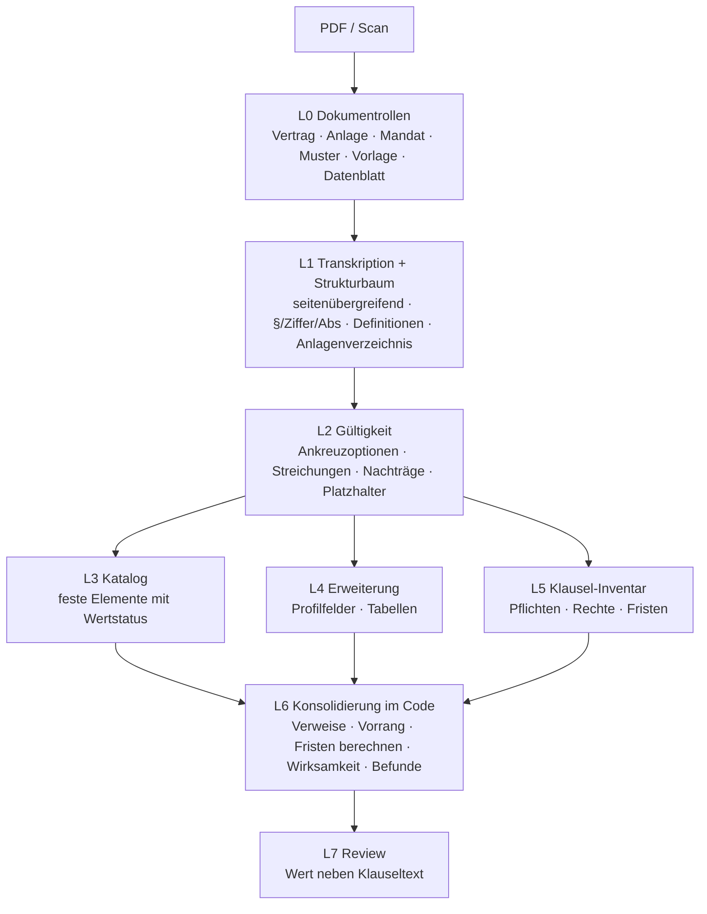

# Konzept: Vertragsextraktion im Document Processing (Entwurf, 2026-10-08)

Status: Konzept- und Diskussionsstand, **nicht umgesetzt**. Grundlage: Analyse von 10 echten Verträgen aus der
Ladeinfrastruktur (Elektro Ehinger / EMobility Netzwerk Deutschland GmbH, „END"), freigegeben zur Nutzung.
Kunden sind hier anonymisiert; die Originale liegen nicht im Repo.

---

## 1. Fragestellung

Document Processing (DP) ist stark darin, **definierte Einzelwerte** aus wiederkehrenden Dokumenten zu holen
(Rezepte, Lieferscheine, Bescheide, Wohngeldanträge). Bei Verträgen kommen zwei Anforderungen zusammen:

- **(a) Steckbrief:** klassische Einzelwerte — Parteien, Vertragstyp, Daten, Laufzeit, Gerichtsstand, Unterschriften.
- **(b) Klausel-Inventar:** Fristen, Pflichten, Rechte, die **verteilt in den Paragraphen** stehen und nur **im Kontext**
  des Paragraphen bzw. seines Titels, der Definitionen und der Querverweise richtig verstanden werden.
  Die Anzahl ist unbekannt — die Qualitätsfrage lautet „alles gefunden?", nicht nur „Wert richtig?".

Vorgeschlagenes Modell (mit dem Fachbereich abgestimmt): **fester Katalog** typischer Vertragselemente plus
**im Profil manuell gepflegte Erweiterungsfelder** je Vertragsart (z. B. Ladeinfrastruktur: Standorte, Ladepunkte,
Hersteller). Profile werden heute von uns begleitend eingerichtet.

## 2. Testkorpus

| # | Vertrag | Seiten | Form | Auffälligkeiten |
|---|---|---|---|---|
| V1 | Wartungsvertrag Ladeinfrastruktur (Gewerbekunde) | 7 | Kopierer-Scan | Anhang 1 als um 90° gedrehte Tabelle (EVSE-IDs, Hersteller); SEPA-Mandat als eigenes Dokument auf S. 7 |
| V2 | „Betreibervertrag" (= Wartungsvertrag) eines Händlers | 6 | Scan | Anhang 1 fehlt; Präambel aus V3 kopiert; Unterschrift END fehlt |
| V3 | Rückvergütungsvereinbarung zu V2 | 2 | Scan | keine eigene Laufzeit — erbt von V2; nur Vertragsnr. verknüpft; wirksam erst bei Unterschrift beider — END fehlt |
| V4 | Betreibervertrag (Verein) | 6 | digital (Gerät) | Kundenunterschrift + Datum **handschriftlich, nicht im Textlayer**; Anlage 1 fehlt |
| V5 | Betreibervertrag (Ingenieurbüro, Tiefgarage) | 8 | digital | als „Anlage 2" eines Rahmenvertrags gestempelt; Entgelt „gemäß Rahmenvertrag"; Kundenunterschrift fehlt; EVSE-Tabelle |
| V6 | Betreibervertrag „privates Laden" (Ingenieurbüro) | 7 | Scan | Preisliste großteils **durchgestrichen**, Ziffer 4 komplett gestrichen, handschriftliche Änderung nach Unterschrift |
| V7 | Rahmenvertrag Lieferung/Montage/Betrieb (Ingenieurbüro) | 5 | Scan | **Anlagen 1–4 fehlen** (Standorte, Preise!); widersprüchliche Preisanpassungsregel |
| V8 | Ladevertrag Endkunde (WEG-Stellplatz) | 4 | Handyfoto | Pflichtdaten handschriftlich; END-Unterschrift fehlt; Widerrufsanlagen fehlen |
| V9 | Ladevertrag Endkunde, neuere Vorlagenversion | 6 | Scan | gleiche Vorlage wie V8, andere Preise; Name handschriftlich korrigiert; END-Unterschrift fehlt |
| V10 | Rahmenvertrag Hotelkette (CPO-Modell) | 89 | **Scan mit OCR-Textlayer** | OCR-Fehler („van", „1st", PLZ ohne führende 0); Definitionen a)–z); 3 Gliederungsebenen; 60 Standorte in Anlagen; Musterrechnung, Datenblätter, leere Standortvertrag-Vorlage im selben PDF |

Gesamt 146 Seiten. Vorlagen: END-Betreibervertrag (V4–V6, Ziffer 1–11), END-Endkundenvertrag (V8–V9, zwei
Versionen), END-Wartungsvertrag (V1–V2, § 1–10); V7 und V10 sind Einzelverträge.

## 3. Kernbefunde

### 3.1 Scans sind der Normalfall — auch „digitale" Verträge brauchen das Bild
- 7 von 10 sind reine Scans/Fotos, V10 ist ein Scan mit fehlerhaftem OCR-Layer. Nur V4/V5 sind echt digital.
- Selbst bei V4 stehen Unterschrift und Datum des Kunden **nur im Bild** — eine reine Textauswertung meldet „nicht
  unterschrieben". Die Unterschriftsseite braucht immer den Bildweg.
- Das heißt: Der Weg „Textlayer → Textstrategie" trägt bei Verträgen kaum. Es braucht eine **Transkription über
  Seitengrenzen hinweg** (Qwen 3.5 per Bild; ein eigenes OCR-Modell ist dafür nicht nötig, vgl. OCR-Pilot).

### 3.2 Paragraphen laufen über Seitengrenzen; Überschriften passen nicht immer zum Inhalt
- In praktisch jedem Vertrag reichen Klauseln über Seiten (V1 § 4 S. 2→3, § 7 S. 3→4; V10 Ziff. 2.5.3, 5.1, 7.5.2,
  12.1 …). Seitenweises Auslesen (`vision-per-page`) verliert dabei den Paragraphentitel.
- Gliederung uneinheitlich: „§ n Abs. m", „Ziffer n" mit **unnummerierten** Absätzen, auf die trotzdem mit „Abs. 3"
  verwiesen wird, „Ziffer 7.5.2" (3 Ebenen), Buchstabenlisten.
- Titel ≠ Inhalt: „Gewährleistung und Haftung" regelt das Forderungsausfallrisiko (V7), „Schriftform/Datenschutz"
  enthält Vertraulichkeit, Rechtswahl und Gerichtsstand. **Zuordnung muss auf Absatzebene passieren**, der Titel ist
  Kontext, kein Schlüssel.

### 3.3 Verträge kommen als Familien und Bündel
- **Hierarchie:** Rahmenvertrag → Standort-/Einzelvertrag (V7 → V5/V6, V10 → künftige Standortverträge);
  Zusatzvereinbarung erbt Laufzeit und Kündigung (V3 → V2). Werte sind „delegiert" oder „geerbt", nicht „fehlend".
- **Bündel in einem PDF:** Vertrag + Anlagen + SEPA-Mandat (V1), Rahmenvertrag + Baubeschreibung + Datenblätter +
  Musterrechnung + leere Vorlage (V10). Muster und Vorlagen dürfen **nicht** als Vertragsinhalt gelten (V10: Tarife
  der Musterrechnung widersprechen dem Haupttext).
- **Fehlende Anlagen** in 6 von 10 Verträgen — oft genau die mit Standorten und Preisen.
- **Vorrangregeln** zwischen Haupttext, Anlagen und Einzelverträgen (V10 § 18.9, Standortvertrag § 8.4).

### 3.4 Gültigkeitsschicht: Was gilt überhaupt?
- Ankreuzoptionen ☒/☐ steuern ganze Klauseln (V4–V6 Ziffer 3/4: Stromversorgung/Wartung durch wen; Ziffer 5 gilt
  nur bei Stromversorgung über den Kunden).
- **Streichungen** maschinell und von Hand, auch innerhalb einer Liste (V6 Preisliste a–l).
- **Änderungen nach Unterschrift**, handschriftlich paraphiert und datiert (V6).
- Vorlagenreste: Platzhalter „XXX", „[ ]", „8.X", leere Felder.

### 3.5 Wirksamkeit und Daten sind abgeleitet, nicht abgelesen
- In **5 von 10** fehlt eine Gegenzeichnung (V2, V3, V5, V8, V9) — teils mit Klausel „wirksam erst bei Unterschrift
  beider". Das ist ein Hauptergebnis, kein Nebenfeld.
- Vertragsbeginn **vor** der (letzten) Unterschrift (V2, V4, V6, V7), bedingter Beginn („frühestens bei Unterzeichnung").
- Mehrere Datumsrollen: Unterschrift je Partei, Wirksamkeit, Laufzeitbeginn, Standortbeginn, Betriebsjahr (V10).

### 3.6 Fristen sind Rechenergebnisse mit Annahmen
- Rollierende Verlängerung: „Mindestlaufzeit 2 J., +1 J., Kündigung 3 Monate vor Ablauf" → **nächster
  Kündigungstermin** ist erst aus Beginn + heutigem Datum berechenbar (Stand 2026-10-08: V1 31.07.2027 — der
  letzte Termin 31.07.2026 ist verpasst; V2 28.02.2027; V4 31.03.2027; V6 30.09.2027; V10 31.03.2030).
- Fristen hängen von anderen Paragraphen ab: V1 § 7 „Erhöhung spätestens 2 Wochen vor der automatischen
  Verlängerung" → Datum erst über § 6.
- Ereignisbezogene Fristen (nach Abnahme, nach Störungsmeldung, nach Inbetriebnahme, Termin ≥ 4 Wochen vorher).
- Eigene Werktagsdefinition (V10: Samstag = Werktag, Feiertage je Standort/Bundesland).
- Mehrdeutigkeit: „3 Monate vor Ablauf der Festlaufzeit oder zum Ende der verlängerten Laufzeit" (V4–V6).
  Jede berechnete Frist braucht **Annahmen** („nicht gekündigt") und ggf. ein **Mehrdeutigkeits-Flag**.

### 3.7 Modalität und Richtung
- „muss" vs. „bemüht sich", „i. d. R.", „ist bestrebt", „nach besten Kräften", „soll", „behält sich vor".
  Ohne diese Unterscheidung wird aus „Störung i. d. R. binnen 5 Werktagen" (V1, V2) fälschlich ein hartes SLA.
- Geldflüsse in beide Richtungen (Entgelt AG→AN, Rückvergütung AN→AG), Begünstigte außerhalb der Parteien
  (Parkhausbetreiber in V5), Pflichten von Nichtparteien (Generalunternehmer in V10).
- Ausschlüsse gehören zum Leistungsumfang („Reinigung ist ausdrücklich kein Bestandteil").
- Bedingte Werte: Gerichtsstand nur für Kaufleute, Widerruf nur für Verbraucher (V8/V9); fast alle Werte in V10
  hängen davon ab, wer den Standort ausbaut (Ziffer 2.4 vs. 2.5).

### 3.8 Verträge enthalten Fehler
Falsche Querverweise (V4/V5 „Ziffer 6" statt 4; V10 5.1 → 12.2 statt 12.3), Widersprüche (V7 § 9 einseitig vs.
einvernehmlich; V5 MwSt. inkl./zzgl.; V10 Bauzuschuss „je Ladepunkt" vs. „je Standort"), Tippfehler in Adressen
(V1 PLZ), vertauschte Parteirollen (V2 § 7). → Neben der Extraktion braucht es eine **Befund-Ausgabe**
(Widerspruch, ins Leere laufender Verweis, fehlende Anlage, Platzhalter).

### 3.9 Der Katalog ist oft leer — das ist normal
Gewährleistung, Vertragsstrafe, Vertraulichkeit, Change of Control, Rechtswahl fehlen in den meisten der 10.
„Nicht geregelt" ist eine **gültige Antwort** und muss von „nicht gefunden" unterscheidbar sein.

### 3.10 Erweiterungsdaten sind Tabellen
Standortlisten (60 Hotels in V10, Mehrfachstandorte in einer Zeile in V6), EVSE-Tabellen mit unregelmäßigen Zeilen
(„Gleich SN wie oben"), Tarife je Nutzergruppe × AC/DC × Startgebühr/kWh/Blockiergebühr. Abgeleitete Werte
(Anzahl Ladepunkte = Tabellenzeilen bzw. Pauschale ÷ Preis je LP) stehen **nirgends ausdrücklich**.
Störgröße: Briefbogen-Fußzeile mit IBAN/Register der END auf jeder Seite — darf nicht als Parteidaten gelten.

## 4. Zielbild: Schichtenmodell

- **L0 Dokumentrollen** — passt zur vorhandenen DP-Segmentierung (Posteingang-Trennung): Abschnittstypen
  „Vertragstext", „Anlage n", „SEPA-Mandat", „Muster/Vorlage", „technisches Datenblatt". Nur Vertragstext und
  verbindliche Anlagen speisen Katalog und Inventar.
- **L1 Strukturbaum** — jede Klausel bekommt eine stabile ID (`§6.3`, `Z7.Abs2`, `10:7.5.2`), Titelpfad und
  Seitenbereich. Unnummerierte Absätze werden implizit gezählt, damit „Abs. 3" auflösbar ist. Definitionen werden
  als eigener Kontext mitgeführt. Gleiches Muster wie das Gesetzes-Nachschlagen der Wohngeld-App: **Das Modell
  wählt Klausel-IDs, die Oberfläche zeigt den Originaltext.**
- **L2 Gültigkeit** — nur geltender Text geht weiter; verworfene Alternativen werden protokolliert.
- **L3 Katalog** — feste Elemente (Abschnitt 5), jedes mit **Wertstatus**:
  `gefunden` · `nicht geregelt` · `referenziert, Anlage fehlt` · `delegiert an Einzelvertrag` · `geerbt von …` ·
  `bedingt (Bedingung …)` · `berechnet (Annahmen …)`.
- **L4 Erweiterung** — Profilfelder aus typisierten Bausteinen (Abschnitt 6), inkl. Tabellen.
- **L5 Klausel-Inventar** — Einträge mit Typ, Partei (auch Dritte), Modalität, Auslöser, Frist, Klausel-ID.
- **L6 Konsolidierung (deterministisch)** — Querverweise auflösen und prüfen, Vorrang anwenden, Fristen mit
  Annahmen berechnen, Wirksamkeitsstatus aus Unterschriften + Wirksamkeitsklausel, Befunde erzeugen.
- **L7 Review** — jeder Wert neben dem Klauseltext; Befunde zur Klärung.

## 5. Katalog v1

Start mit Elementen, deren Logik wir genau kennen; alles andere zunächst als Erweiterung.

| Element | Typ / Besonderheit aus dem Korpus |
|---|---|
| Parteien | mit Rollen-Aliassen (AG/AN/„Kunde"/„uns"), Konzernbeitritt (V10) |
| Vertragsart | aus dem Inhalt klassifiziert, Titel nur Hinweis (V2: Titel „Betreibervertrag", Inhalt Wartung) |
| Vertragsbeziehungen | Rahmen-/Einzelvertrag, Zusatzvereinbarung, ersetzt Vorgängervertrag (V1 Präambel); Verknüpfungsschlüssel Vertragsnr. |
| Unterschriften | je Partei: vorhanden, Datum, Ort, Stempel, Vertretung (ppa.) — **Bildweg Pflicht** |
| Daten | typisierte Rollen: Unterzeichnung je Partei, Wirksamkeit, Beginn, Mindestlaufzeit-Ende |
| Laufzeit & Verlängerung | Mindestlaufzeit, Verlängerungsschritt, ggf. je Ebene (Rahmen 5 J./Standort 8 J.) |
| Kündigung | Frist, Bezugspunkt, Form, außerordentliche Gründe; **nächster Termin berechnet** |
| Entgelte & Zahlung | Richtung, Betrag/Formel, Bezugsgröße (je LP/Monat), Rhythmus, Zahlungsziel |
| Preisanpassung | als **Liste** (mehrere Klauseln mit eigenen Auslösern/Fristen) |
| Haftung | Ausschlüsse, Höchstbetrag (oft nur qualitativ), Versicherung |
| Gewährleistung / Verfügbarkeit / SLA | mit Modalität (Garantie vs. „i. d. R.") |
| Vertragsstrafe | Höhe, Deckel |
| Vertraulichkeit, Exklusivität, Wettbewerbsverbot | |
| Gerichtsstand, Rechtswahl, Schriftform | ggf. bedingt (Kaufmann) |
| Widerruf | nur Verbraucherverträge |

## 6. Profile und Erweiterung

- **Bausteintypen** statt freier Felder: *Wert*, *Liste/Tabelle von Objekten*, *Frist* (Regel + Auslöser, wird
  berechnet), *Pflicht/Recht*. Jedes Feld — auch ein manuell ergänztes — bekommt automatisch Fundstelle und Wertstatus.
- **Optionaler Fundort-Hinweis** je Feld („Anlage 1", „Ziffer 5"): nur passende Klauseln gehen ans Modell.
- **Katalog und Erweiterung getrennt halten** (eigene versionierte Schicht), damit Katalogverbesserungen alle
  Profile erreichen, ohne gepflegte Erweiterungen zu überschreiben (Lehre aus dem Wohngeld-Vorlagenstand).
- **Profile stapelbar** statt ein Profil je Vertragstitel: Ein Dokument kann Wartung + Backend + Erlösbeteiligung
  enthalten (V2/V3, V4–V6). Vorschlag für die Domäne:
  - *Wartung/Service* (Intervall, Stundensatz, Ersatzteilgrenze, Störungsbearbeitung),
  - *Betrieb/CPO* (Tarife je Nutzergruppe, Erlösanteil, THG-Quote, Stromversorgung durch wen),
  - *Endkunden-Ladevertrag* (Stellplatz, Karten, kWh-Preis, Grundgebühr, Widerruf),
  - *Rahmenvertrag* (Standortliste, Einzelvertrags-Mechanik, Vorrang, Ausbaustufen).
- **Vorlagenabgleich** als eigener Weg: V4–V6 bzw. V8–V9 sind dieselbe END-Vorlage. Kennt das Profil die Vorlage
  (inkl. Version, erkennbar an wiederkehrenden Vorlagenfehlern), genügt es, **Abweichungen** und ausgefüllte Felder
  zu prüfen — robuster und billiger als volle Extraktion, und der Blick geht auf Handschrift, Kreuze, Streichungen.

## 7. Abgleich mit dem heutigen DP

| Baustein | heute | Lücke für Verträge |
|---|---|---|
| Segmentierung (Posteingang) | seitenbasierte Abschnitte je Dokumenttyp | trägt L0 weitgehend; Rollen „Muster/Vorlage" ergänzen |
| Text-Chunker | Markdown-Überschriften, 8000 Token, 500 Overlap | Scans haben keine Überschriften; Chunk kennt nur die erste Überschrift; Definitionen fehlen im Chunk → ersetzt durch L1-Strukturbaum |
| `vision-per-page` | eine Seite je Aufruf | verliert Kontext bei seitenübergreifenden Klauseln → erst Transkription, dann Struktur |
| Listen-Merge `union` | hängt an, keine Dublettenbereinigung | Dubletten durch Overlap; Dedup über Klausel-ID |
| Provenance | je Feld auf Chunk-Ebene | je Eintrag auf Klausel-ID |
| Tesseract-Belege | Wortabgleich für kurze Werte | für sinngemäß wiedergegebene Pflichten ungeeignet → Beleg = Klausel |
| Validierungsregeln | Einzelwert-Regeln | Summen-/Plausibilitätsprüfungen nutzbar; Befundtypen ergänzen |
| Vertragsmanagement-App | flache Schemas (`kuendigungsfrist_tage: number`), `hybrid` | Datentypen zu arm für „3 Monate zum Quartalsende" |

## 8. Messung

Golden Set aus diesen 10 Verträgen: je Vertrag die erwarteten Katalogwerte mit Wertstatus und Klausel-ID, die
Erweiterungsfelder und eine annotierte Liste der Fristen/Pflichten. Kennzahlen: Katalog richtig (inkl. Status),
Inventar-Vollständigkeit je Eintragstyp, berechnete Termine richtig, Befunde gefunden (fehlende Anlagen,
fehlende Gegenzeichnung, Widersprüche). Erweiterung um weitere Verträge je Profil (5–10 je Typ).

## 9. Offene Fragen

1. Wofür vorrangig: **Fristenkalender** (Kündigungs-/Mitteilungstermine) oder **Vertragsprüfung** (Risiken,
   Abweichungen von der Vorlage)? Bestimmt Reihenfolge und Katalogumfang.
2. Vertragsfamilien: Soll DP Verträge untereinander verknüpfen (Rahmen ↔ Einzelvertrag ↔ Zusatz), oder liefert DP
   je Dokument und die Verknüpfung macht die Vertragsmanagement-App?
3. Vorlagenabgleich für eigene Vorlagen (END) als erster Schritt — höchster Nutzen bei geringstem Risiko?
4. Umgang mit fehlenden Anlagen und Gegenzeichnungen: nur Befund, oder Workflow (Nachforderung)?
5. Wo lebt das: als neue DP-Strategie + Profiltyp (Katalog/Bausteine), genutzt von der Vertragsmanagement-App —
   oder zunächst als eigene App wie Wohngeld?

## Anhang: Durchgerechnetes Beispiel V1 (Wartungsvertrag)

| Element | Wert | Fundstelle |
|---|---|---|
| Parteien | AG: Gewerbekunde (Frankfurt); AN: END | Deckblatt |
| Vertragsart | Wartung wiederkehrende Prüfung Ladeinfrastruktur inkl. Backendanbindung; ersetzt Wartungsvertrag 07/2020 mit Vorgängerfirma | Deckblatt, Präambel |
| Beginn / Mindestlaufzeit | 01.11.2022 / 2 Jahre | § 6 Abs. 1 |
| Verlängerung | automatisch +1 Jahr, sofern nicht „wie unter § 6 Abs. 3" gekündigt | § 6 Abs. 2 → § 6 Abs. 3 |
| Kündigung | 3 Monate vor Ablauf, beide Seiten, Schriftform | § 6 Abs. 3, 5 |
| **berechnet** | laufende Periode 01.11.2025–31.10.2026; Kündigungstermin 31.07.2026 **verstrichen** → Verlängerung bis 31.10.2027; nächster Termin **31.07.2027** (Annahme: nicht gekündigt) | § 6 Abs. 1–3 |
| Entgelt | 20 € je Ladepunkt/Monat zzgl. MwSt., Monatsbeginn per SEPA | § 4 Abs. 1–3 |
| Mehraufwand | 85 €/h + Anfahrt; Ersatzteile bis 100 €/Einsatz ohne Freigabe | § 4 Abs. 4–5 |
| Preisanpassung | AN einseitig, wirksam ab neuem Vertragsjahr, Mitteilung **spätestens 2 Wochen vor Verlängerung** (≈ 17.10.) | § 7 Abs. 1 → § 6 |
| Haftung | auf Haftpflichtversicherung begrenzt, max. 2,557 Mio. € je Schadensereignis; Vorsatz/grobe Fahrlässigkeit gesetzlich | § 8 Abs. 2 |
| Störung | „i. d. R." binnen 5 Werktagen, AN „bemüht sich" → **kein hartes SLA** | § 9 |
| Ausschluss | Reinigung des Gehäuses „ausdrücklich kein Bestandteil" | § 3 Abs. 2 |
| Pflichten AG | Zugang, Unterlagen/Schlüssel; trägt Betriebsstrom | § 5 |
| Unterschriften | AG 01.11.2022, AN 26.10.2022, beide mit Stempel | S. 5 |
| Erweiterung: Anlagen | 1 Standort, 2 Ladepunkte (EVSE …001/…002), OCPP 1/2, Hersteller Mennekes, Steuergerät EE101 | Anhang 1 (S. 6, gedreht) |
| **abgeleitet** | 2 Ladepunkte → 40 €/Monat | Anhang 1 × § 4 Abs. 2 |
| Befunde | PLZ in § 1 weicht von Kopf/Anhang ab; Ansprechpartner/Störungsadresse noch bei der Vorgängerfirma | § 1, § 9 |
| Weiteres Dokument im PDF | SEPA-Basislastschriftmandat (S. 7) | S. 7 |
